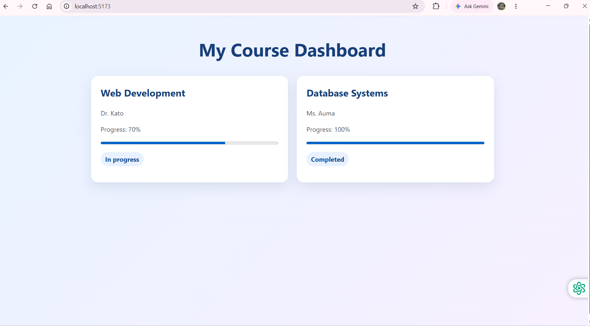
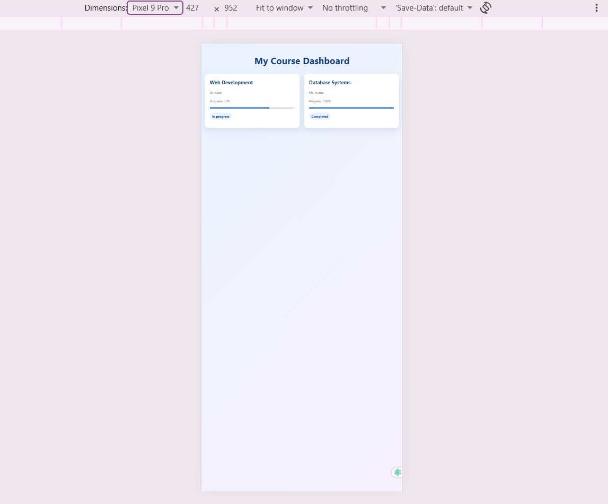

# Student Course Dashboard

A responsive React dashboard for viewing course information, lecturer names, progress, and completion status.

## Features

- Reusable `CourseCard` component that receives course details through props
- Course cards rendered from an array with `map()` and stable IDs as keys
- Progress indicators for each course
- Conditional status labels: **Completed** or **In progress**
- Helpful message when there are no courses
- Responsive layout for desktop and phone screens
- Hover effects on the title and course cards

## Technologies

- React
- JavaScript
- Vite
- CSS

## Project structure

lab1_starter/
├── index.html
├── package.json
├── package-lock.json
├── README.md
├── screenshots/
│   ├── desktop.png
│   └── mobile.png
└── src/
    ├── App.jsx
    ├── main.jsx
    ├── styles.css
    └── data/
        └── courses.js

## Run the project locally

### Requirements

Install [Node.js](https://nodejs.org/) and npm.

### Setup

1. Open the `lab1_starter` folder in VS Code.
2. Open a terminal in that folder.
3. Install the project dependencies:

npm install

4. Start the development server:

npm run dev

5. Open the local address shown in the terminal.

## Screenshots

### Desktop view

### Phone view

## Component overview

`App` imports the course array and renders one `CourseCard` for each course. Each card receives a course object through its `course` prop and displays its title, lecturer, progress, and status.
